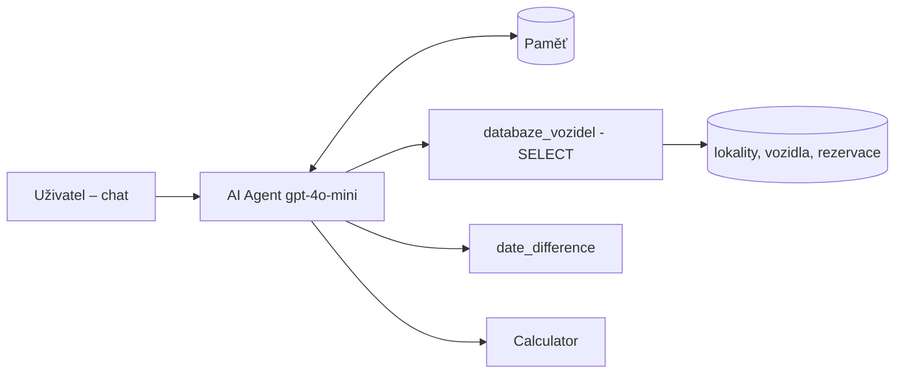

# Homework 02 – No-code agent: Vozový park

Agent odpovídá na dotazy o vozovém parku (vozidla, lokality, rezervace).
Pracuje s **databází**, používá **nástroje** a odpovídá přes **LLM** (OpenAI gpt-4o-mini).
Navrženo ve dvou platformách: **n8n** a **LangFlow**.

## Jak to funguje

1. Uživatel napíše dotaz do chatu.
2. LLM podle schématu databáze vygeneruje SQL dotaz (pouze SELECT).
3. Nástroj dotaz spustí a vrátí řádky.
4. Je-li potřeba, LLM dopočítá výsledek (dny, km) dalším nástrojem.
5. Agent odpoví česky.

## Soubory

| Soubor | Popis |
|---|---|
| `db/init.sql` | schéma + testovací data |
| `n8n/agent_vozovy_park_n8n.json` | workflow pro n8n (Chat Trigger, AI Agent, Postgres Tool, Code Tool, Calculator) |
| `langflow/databaze_vozidel.py` | custom komponenta LangFlow (SQLite, jen čtení) |
| `langflow/agent_vozovy_park_langflow.json` | export flow z LangFlow |

## Příklady dotazů

- Která auta v Brně jsou volná 1. 12. 2026?
- Kterým vozům se blíží servis?
- Kolik km najel Jan Novák ve 3. kvartálu 2026?
- Kolik dní zbývá do rezervace Lucie Černé?

## Bezpečnost

Agent smí data jen číst: v n8n přes DB uživatele s právem SELECT, v LangFlow
komponenta povolí jen jeden SELECT a databázi otevírá v režimu read-only.
API klíče nejsou součástí exportů.